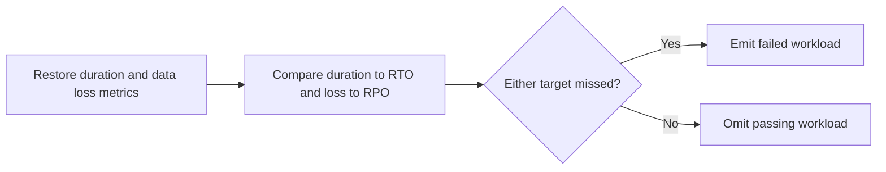

# Restore Readiness Drill Tracker

Tracks restore drill results and flags workloads that missed RTO or RPO targets.

Focus: Backup-platform DevSecOps recovery.

Built as a small, runnable Python project with clear input, output, sample data, and tests.

## Run

```bash
python3 restore_tracker.py sample_drills.csv
```

## Verify

```bash
python3 -m unittest discover . -v
```

## Local verification

Run `make verify` with Make and Python 3 installed. The target runs the documented sample through the project CLI. It also runs the existing Python unit tests.

## Project walkthrough



[Architecture and data flow](docs/ARCHITECTURE.md) · [Business problem, demo, and verification](docs/CASE_STUDY.md)
